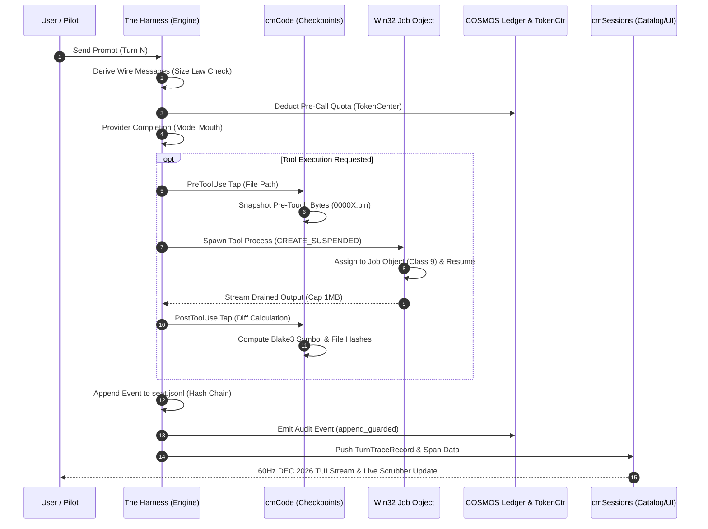
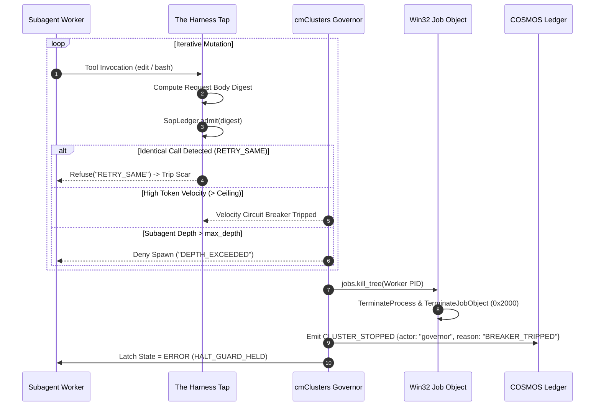
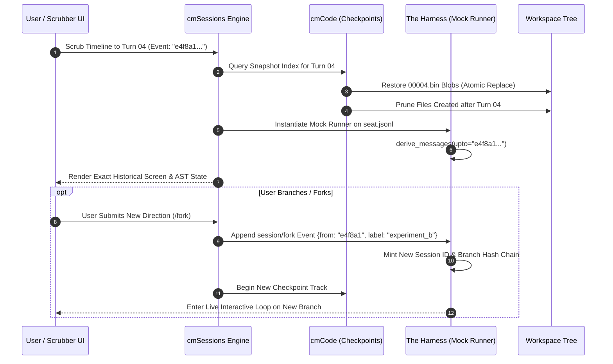
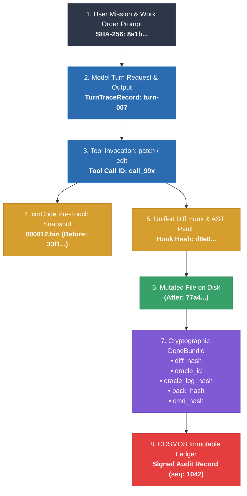

# REPLAY & TnT Architectural Mapping Across the COSMOS Ecosystem
**Target Ecosystem:** `cmSessions` · `cmCode` · `COSMOS` · `The Harness` · `cmClusters`  
**Reference Corpora:** `W:\Cosmos_code_repo` & `W:\Cosmos_code_repo\harness_repo`  
**Status:** Definitive Architectural Specification & Placement Matrix  
**Authoring Authority:** Staff Systems Architect (Deterministic Multi-Harness Governance)

---

## Executive Architectural Summary

Autonomous AI multi-agent software engineering demands two foundational capabilities that traditional logging and ad-hoc chat transcripts fail to provide:
1. **REPLAY (Deterministic Session Playback & Time-Travel):** The ability to step backwards and forwards through an agent session, inspect wire derivations, replay tool outputs without side-effects, visualize reasoning-to-action transitions, and branch (fork) a new live session from any arbitrary historical turn.
2. **TnT (Tracking, Tracing & Swarm Forensics):** The capability to establish end-to-end cryptographic provenance from prompt intent to disk mutations (Prompt $\to$ Tool Invocation $\to$ AST Hunk $\to$ Patch $\to$ File Byte Hash), while enforcing runtime blast-radius containment across distributed multi-agent swarms.

Within the COSMOS multi-harness architecture, these capabilities do not live in an isolated monolith. Instead, they are stratified cleanly across five distinct architectural tiers:

```
┌─────────────────────────────────────────────────────────────────────────────────────────┐
│                                       cmSessions                                        │
│  UI Scrubber • DAG Tree Explorer • Flamegraph • Multi-Harness Ingest (26 Formats)       │
└───────────────────────────────────────────┬─────────────────────────────────────────────┘
                                            │ Wire DAGs & Traces (JSONL / W3C)
┌───────────────────────────────────────────▼─────────────────────────────────────────────┐
│                                         COSMOS                                          │
│  Canonical OS Substrate • Immutable Ledger • Audit Broker • Spend Authority (TokenCtr)  │
└──────────────┬────────────────────────────┬─────────────────────────────┬───────────────┘
               │ Event Stream               │ Pen Leases                  │ Delegations
┌──────────────▼────────────┐ ┌─────────────▼─────────────┐ ┌─────────────▼─────────────┐
│        cmClusters         │ │        The Harness        │ │           cmCode            │
│ Distributed Trace Context │ │ In-Process Tap & Mock Play│ │ Checkpoint Blobs (.bin)     │
│ W3C Traceparent / Spans   │ │ Win32 Job Object (Class 9)│ │ AST / Hashline Invariants   │
│ Swarm Blast Radius Limiter│ │ Runaway Circuit Breaker   │ │ Patch Lineage & Rollback    │
│ Pilot / Manager / Worker  │ │ Size Law & 23 Scars / SOPs│ │ Reverse Diff Generator      │
└───────────────────────────┘ └───────────────────────────┘ └─────────────────────────────┘
```

---

## 1. System Component Responsibilities

### 1.1 `cmSessions`: Presentation, Navigation & Multi-Harness Lake
`cmSessions` (evolved from `sessions_page` and `cosmos_session_tools_kit.py`) serves as the universal session catalog, visualization surface, and timeline playback controller. It operates strictly in user-space, reading immutable journals and traces without mutating runtime state.

* **REPLAY Responsibilities:**
  * **Playback Timeline Scrubber:** Provides microsecond-level play, pause, step-forward, step-backward, and scrub controls across turn sequences.
  * **DAG Tree Explorer:** Visualizes the non-linear event graph (`Event.parent` hash chains, `session/rewind`, `session/fork`, and `session/compact`), allowing users to click any historical node and inspect the exact wire state derived at that point in time.
  * **Deterministic State Hydration:** Sends playback commands to `The Harness`'s mock runner to simulate past tool results without re-executing external commands.
  * **Branch / Fork Orchestration:** Initiates session forking (`POST /api/v1/sessions/fork`) by addressing a target `event_id`, decoupling historical immutable journals from the new speculative session branch.
* **TnT (Tracking & Tracing) Responsibilities:**
  * **Unified Multi-Harness Session Catalog:** Ingests, normalizes, indexes, and searches transcripts across 26 heterogeneous harnesses (`grok`, `claude`, `codex`, `cursor`, `gemini`, `hermes`, `cline`, `kilo`, `roo`, `pi`, `copilot`, `aider`, `goose`, `openhands`, `dsh`, etc.) via `engine.py`.
  * **Swarm Flamegraph & Waterfall Visualizer:** Renders nested W3C distributed trace spans (`traceparent`, `span_id`, `parent_span_id`), depicting concurrency, parent-to-subagent delegation latency, tool execution runtimes, and token consumption bottlenecks.
  * **Forensic Audit Exporter:** Produces cryptographically bound, verifiable compliance dossiers (HTML, JSONL, DOI archive packages). Executes automated secret scrubbing using the canonical 11-rule regex engine (`_REDACT` for Slack webhooks, Anthropic/OpenAI/xAI/AWS/Google keys, bearer tokens).

### 1.2 `cmCode`: Work Product Lineage & Worktree Time-Machine
`cmCode` (rooted in `2026-10-14_v4_definitive_agent/cosmos_code/checkpoints.py`, `diff_engine.py`, and `ast_nav.py`) manages filesystem mutations, code artifacts, and AST semantic integrity. It ensures that every line of code on disk is traceable to an exact model turn and can be surgically inverted.

* **REPLAY Responsibilities:**
  * **Turn-Level Checkpoint Snapshots:** Intercepts mutating tools (`write`, `edit`, `patch`, `archive_rewrite`) and captures pre-mutation file bytes into content-addressed blobs (`000001.bin`, indexed in `index.json`) before a byte touches disk.
  * **File Tree Time-Travel (`/undo` & `/rewind`):** Restores the precise on-disk state of any given turn key. If a user rewinds to Turn $N$, `cmCode` deletes files created after $N$, un-archives staged deletions from `_delme/`, and writes back exact checkpoint blobs.
  * **Reverse Diff Generation:** Computes synthetic inverse patches ($A \to B \implies B \to A$) enabling step-by-step UI visualization of how code evolved backwards during playback.
* **TnT (Tracking & Tracing) Responsibilities:**
  * **Work Product Lineage Anchor:** Computes 4-byte Blake3 and SHA-256 semantic hashes for every affected symbol, function scope, and whole file before and after every tool invocation.
  * **Hunk-Level Provenance Mapping:** Couples unified diff hunks (`@@ -l,s +l,s @@`) directly to the generating model turn, subagent ID, and tool call ID, establishing undeniable attribution for every landed byte.
  * **AST Scope Pinning:** Validates that mutations respect declared invariant boundaries (`[INVARIANTS]` in `CarryOverPacket`, e.g., signature stability `h:8a4f`), flagging scope drift or AST corruption before acceptance.

### 1.3 `COSMOS`: System OS Substrate, Event Bus & Policy Arbiter
`COSMOS` (`2026-09-17_core_os_substrate` and `COSMOS_V5_Master_Architecture_Spec.md`) is the authoritative operating system substrate, coordinating security policies, spend accounting, and inter-component messaging.

* **REPLAY Responsibilities:**
  * **Canonical Session Schema Authority:** Defines and enforces the immutable event schema (`cosmos-session-dag/1`, `cosmos-transcript/1`). Rejects malformed or tampered journals via content-address verification (`id == sha256(canonical(body))[:16]`).
  * **Fenced Commit & Replay Pen Guard:** Enforces strict lease-pen semantics (`cosmos_lock.py`, `assert_pen`). During Replay/Playback, the publishing pen (`live/` write privilege) is permanently revoked (`pen = None`), preventing accidental live mutations during inspection.
* **TnT (Tracking & Tracing) Responsibilities:**
  * **Cryptographic Event Ledger:** Maintains the system-wide append-only ledger (`cosmos_ledger.py`, `append_guarded`). Records every session lifecycle change, permission grant, model invocation digest, and policy refusal.
  * **Wholesale Token Metering & Billing Breaker:** Via `TokenCenter` (`cosmos_pay_gateway.py`, `meter.py`, `gcp_billing_breaker.py`), tracks exact prompt, cached, thinking, and completion tokens per session and per agent. Trips the hard budget breaker before upstream quotas are breached.
  * **Cross-Component Audit Broker:** Exposes secure REST/WebSocket query endpoints (`/api/v1/audit/lineage`, `/api/v1/sessions/verify`) allowing compliance tools to verify that a deployed binary or landed file matches a signed `DoneBundle`.

### 1.4 `The Harness`: In-Process Runtime Tap & Deterministic Execution Chassis
`The Harness` (`harness_repo/2026-10-14_v4_definitive_rewrite/cosmos_harness`) is the in-process execution engine. It governs the turn loop, isolates processes, and enforces mathematical determinism.

* **REPLAY Responsibilities:**
  * **`derive == wire` Invariant:** Guarantees that the wire messages fed to the model are derived strictly and deterministically from the session DAG (`seat.jsonl`). An offline replay produces byte-identical request bodies.
  * **In-Process Runtime Tap:** Provides hook taps (`PreToolUse`, `PostToolUse`, `OutputFilter`) that capture raw inputs, raw outputs, exit codes, and streaming chunks without altering execution timings.
  * **Mock Tool Playback Dispatcher:** In Replay Mode, replaces live execution hands (`bash`, `edit`, `python`) with a zero-side-effect mock runner that returns recorded historical payloads, verifying that the agent's internal FSM reacts identically.
* **TnT (Tracking & Tracing) Responsibilities:**
  * **Win32 Job Object Enclosure (Kernel Class 9):** Executes all child processes inside unnamed Win32 Job Objects (`KILL_ON_JOB_CLOSE (0x2000)`, `ACTIVE_PROCESS (0x0008)`, `DIE_ON_UNHANDLED_EXCEPTION (0x0400)`). Limits active processes to 4 (oracle) and 16 (checkers), preventing runaway forks.
  * **Credential Scrubbing (`scrub_env`):** Purges all secrets, tokens, and keys from subprocess environments, ensuring that trace logs and child stderr dumps never capture credentials.
  * **Runaway Loop Circuit Breaker:** Implements the 23-scar classification taxonomy (`scars.py`). Detects identical repeated queries (`RETRY_SAME = False`), context exhaustion (`MAX_LE_ZERO`), and trips `HALT_GUARD_HELD` when an unhandled error loop is detected.
  * **Cryptographic 5-Hash `DoneBundle` Generation:** Generates the terminal attestation bundle (`diff_hash`, `oracle_id`, `oracle_log_hash`, `pack_hash`, `cmd_hash`), verifying that green test logs correspond to genuine mutations.

### 1.5 `cmClusters`: Swarm Coordination & Distributed Forensics
`cmClusters` (`2026-10-01_cluster_and_sessions/cluster_opus/PLUGINS_PLAN.md` Phase 4–6 and `cosmos_delegate.py`) manages multi-agent swarms, remote worker seats, and delegation hierarchies.

* **REPLAY Responsibilities:**
  * **Coordinated Multi-Timeline Sync:** Reconstructs the causality tree across hierarchical agent swarms (Pilot $\to$ Manager $\to$ Leaf Workers). Locks timestamps to an injected logical clock so concurrent subagent executions can be stepped through deterministically.
  * **Subagent Session Isolation:** Ensures each worker maintains an independent `session_log` (`.cosmos/worktrees/<agent-id>/seat.jsonl`), allowing individual workers to be scrubbed and replayed independently of the parent swarm.
* **TnT (Tracking & Tracing) Responsibilities:**
  * **Distributed W3C Trace Injection:** Injects and propagates standard W3C `traceparent` headers (`00-{trace_id}-{span_id}-{flags}`) across inter-agent messages, tasks, and remote RPC delegates.
  * **Process Tree Tracking (`jobs.kill_tree`):** Tracks OS PID trees across local and remote delegate seats. On stop or timeout, guarantees 100% process tree teardown without leaving orphaned worker daemons.
  * **Swarm Blast Radius Limiter:** Enforces strict multi-agent governance:
    * `max_depth` (default $\le 3$): Prevents recursive subagent generation loops.
    * `max_fanout` / `max_agents` (default $\le 8$): Caps total concurrent running agents.
    * `budget_usd` & `iteration_budget`: Enforces monotonic budget decrease—a manager can lower a worker's budget but can never exceed the parent allocation.
    * `idle_flash_s` (default 20s): Automatically flags or suspends stalled/zombie agents.

---

## 2. Architecture Placement Matrix

| System Component | REPLAY Domain Responsibility | TnT Domain Responsibility | Primary Data Inputs | Primary Data Outputs | Authoritative Interfaces / Protocols |
| :--- | :--- | :--- | :--- | :--- | :--- |
| **`cmSessions`** | • Scrubber timeline playback<br>• Visual DAG explorer (`chain`)<br>• Branch/fork session triggers<br>• State diff visualization | • Ingestion of 26 harness formats<br>• W3C trace flamegraph rendering<br>• Anonymized forensic export<br>• Audit report generation | • On-disk `seat.jsonl` DAGs<br>• W3C `TurnTraceRecord` spans<br>• Foreign transcripts (CLI/DB)<br>• User UI scrub/play events | • Web UI (`:8786`) / cDeck views<br>• Normalized JSONL transcripts<br>• Redacted audit compliance packs<br>• Fork requests (`from_event_id`) | • `cosmos-session-tools-result/1`<br>• `cosmos-transcript/1`<br>• `REST /api/v1/sessions/*`<br>• `deck/sessions.js` |
| **`cmCode`** | • Pre-touch byte restore<br>• Multi-turn file rollback<br>• Synthetic reverse diffs<br>• Un-archive staged deletions | • Work product SHA-256 lineage<br>• Hunk-to-turn attribution<br>• AST semantic scope pinning<br>• Workspace snapshot index | • Mutating tool calls (`edit`, etc.)<br>• Live file tree on disk<br>• Target turn rollback key<br>• Patch definitions (Lark/diff) | • Content-addressed blobs (`.bin`)<br>• `index.json` snapshot manifests<br>• Restored on-disk workspace<br>• Reverse patch streams | • `Checkpoints` Protocol (`checkpoints.py`)<br>• `diff_engine.py`<br>• `ast_nav.py`<br>• Gitur patch grammar |
| **`COSMOS`** | • Session schema verification<br>• Lease pen lock (`pen=None`)<br>• Playback sandbox isolation<br>• Verified-head read cache | • Cryptographic event ledger<br>• Unified spend & quota breaker<br>• Cross-component audit broker<br>• Capability token minting | • Raw ledger events (`Event`)<br>• Provider usage telemetry<br>• Lineage audit requests<br>• Plugin registration manifests | • Append-only `cosmos_ledger.py`<br>• Wallet spend ledger (SQLite)<br>• TokenCenter quota alerts<br>• Signed audit attestations | • `cosmos-ledger/1` (`append_guarded`)<br>• `REST /api/v1/audit/*`<br>• `TokenCenter` Gateway (`POST /v1/*`)<br>• `cosmos_ccr.assert_pen` |
| **`The Harness`** | • `derive == wire` verification<br>• Mock tool runner dispatch<br>• In-process runtime tap<br>• Synthetic unclosed balancing | • Win32 Job Object containment<br>• Credential purge (`scrub_env`)<br>• 23-scar loop circuit breaker<br>• 5-hash `DoneBundle` closure | • Work order mission & prompt<br>• Tool call requests/results<br>• Size Law context parameters<br>• Win32 process handles | • Content-addressed `seat.jsonl`<br>• `TurnTraceRecord` streams<br>• `DoneBundle` evidence object<br>• Latching refusals (`Refuse`) | • `EngineConfig` / `TurnResult`<br>• `Class 9 JobObject` Win32 API<br>• `SopLedger.admit(digest)`<br>• `Size Law` arithmetic formula |
| **`cmClusters`** | • Multi-timeline synchronization<br>• Logical clock coordinator<br>• Subagent session isolation<br>• Replay of delegation trees | • W3C `traceparent` injection<br>• Remote process tree tracking<br>• Swarm blast radius limiter<br>• Monotonic budget depletion | • Pilot & Manager delegation verbs<br>• Worker status & usage telemetry<br>• Worktree allocation requests<br>• Inter-agent messages | • Delegated task manifests<br>• Swarm trace span hierarchies<br>• Kill tree signals (`jobs.py`)<br>• Clustered spend aggregates | • `cosmos-plugin/1` (`clusters`)<br>• `W3C Trace Context (v1)`<br>• `ClusterEngine` / `authority.py`<br>• `cosmos_delegate.py` |

---

## 3. Detailed Data Flows & Sequence Diagrams

### 3.1 Normal Turn Execution & Trace Emission
During standard execution, every action passes through the harness tap, commits to the DAG, updates file checkpoints, meters tokens, and emits a W3C trace record.



### 3.2 Runaway Swarm Detection & Circuit Breaker Tripping
When a swarm worker enters an infinite loop, exceeds its fanout cap, or repeats tool invocations, the circuit breaker intervenes fail-closed.



### 3.3 Replay Scrubbing & Branching into a New Session
When scrubbing backwards to an earlier turn, `cmSessions` drives `cmCode` to restore file state and branches the content-addressed DAG.



### 3.4 Work Product Lineage Audit
Verifying the complete cryptographic chain of custody from user requirement to code committed on disk.



---

## 4. Concrete Protocol & Schema Proposals

### 4.1 `TurnTraceRecord` Schema (`cosmos-trace-turn/1`)
Emitted on every turn by `The Harness` and consumed by `cmSessions` for flamegraphs, replay, and timeline scrubbing. Written as single-line JSONL.

```json
{
  "$schema": "https://cosmos.engine/schemas/trace-turn-v1.json",
  "v": 1,
  "record_id": "tr-7f8b9c1d0e2a3b4c",
  "traceparent": "00-4bf92f3577b34da6a3ce929d0e0e4736-00f067aa0ba902b7-01",
  "session_id": "ses-2026-10-14-v4-0012",
  "turn_index": 4,
  "parent_turn_id": "tr-1a2b3c4d5e6f7a8b",
  "agent_id": "a-9f12c4",
  "parent_agent_id": "a-pilot",
  "cluster_id": "c-001a",
  "timestamps": {
    "start_epoch_us": 1791964800100000,
    "first_token_epoch_us": 1791964800350000,
    "end_epoch_us": 1791964802120000,
    "duration_ms": 2020.0
  },
  "provider_telemetry": {
    "provider": "vertex",
    "requested_pin": "google/gemini-3.8-pro",
    "served_model": "google/gemini-3.8-pro-202610",
    "sku_bound": true,
    "tokens": {
      "prompt": 12450,
      "cached": 9800,
      "thinking": 840,
      "completion": 320,
      "total": 13610
    },
    "cost_usd": 0.00412,
    "size_law": {
      "window": 1000000,
      "margin_reserved": 200000,
      "max_le_zero_tripped": false
    }
  },
  "mouth_contract": {
    "role": "coder",
    "first_line_token": "diff --git",
    "status": "LOOKS_SHAPED",
    "scar_class": null
  },
  "tool_invocations": [
    {
      "tool_call_id": "call_patch_001",
      "tool_name": "patch",
      "span_id": "span-00f067aa0ba902c1",
      "arguments": {
        "path": "src/core/router.py",
        "hunks": ["@@ -12,4 +12,6 @@ ..."]
      },
      "execution": {
        "enclosure": "win32_job",
        "job_active_limit": 4,
        "exit_code": 0,
        "stdout_head_tail": "1 file modified, 2 insertions(+)",
        "duration_ms": 45.2
      },
      "artifacts_modified": [
        {
          "artifact_id": "art-src-core-router-py",
          "path": "src/core/router.py",
          "lineage_hash": "lin-88fa01e9c2b3"
        }
      ]
    }
  ],
  "dag_anchor": {
    "event_id": "e4f8a1c90b2d3e4f",
    "event_seq": 14,
    "event_sha256": "e4f8a1c90b2d3e4fa8b1c2d3e4f5a6b7c8d9e0f1a2b3c4d5e6f7a8b9c0d1e2f3"
  }
}
```

### 4.2 `ArtifactLineageRecord` Schema (`cosmos-lineage-artifact/1`)
Maintained by `cmCode` to prove atomic transformation of every code entity across all turns.

```json
{
  "$schema": "https://cosmos.engine/schemas/lineage-artifact-v1.json",
  "v": 1,
  "lineage_id": "lin-88fa01e9c2b3",
  "artifact_id": "art-src-core-router-py",
  "file_path": "src/core/router.py",
  "project_root": "W:/Cosmos_code_repo/active_project",
  "producer": {
    "turn_id": "tr-7f8b9c1d0e2a3b4c",
    "agent_id": "a-9f12c4",
    "tool_call_id": "call_patch_001"
  },
  "hashes": {
    "algorithm": "sha256",
    "before_touch": "33f1a0e8d9c7b6a5e4d3c2b1a0f9e8d7c6b5a4e3d2c1b0a9f8e7d6c5b4a3e2d1",
    "after_landed": "77a4c9b2e1f0a8d7c6b5e4d3c2b1a0f9e8d7c6b5a4e3d2c1b0a9f8e7d6c5b4a3",
    "checkpoint_blob": ".cosmos/checkpoints/000012.bin"
  },
  "semantic_ast": {
    "language": "python",
    "enclosing_symbol": "src/core/router.py::RouteDispatcher::dispatch",
    "symbol_scope_hash_before": "8a4f",
    "symbol_scope_hash_after": "9b12",
    "invariants_checked": ["I01: PRESERVE_SIG", "I02: NO_MUTATE schema.py"]
  },
  "diff_evidence": {
    "format": "unified_diff",
    "hunk_count": 1,
    "lines_added": 2,
    "lines_removed": 0,
    "diff_text": "--- a/src/core/router.py\n+++ b/src/core/router.py\n@@ -12,4 +12,6 @@\n+    if not token:\n+        raise AuthError('TOKEN_EMPTY')\n"
  },
  "reverse_patch": {
    "available": true,
    "inversion_verified": true,
    "reverse_diff_text": "--- b/src/core/router.py\n+++ a/src/core/router.py\n@@ -12,6 +12,4 @@\n-    if not token:\n-        raise AuthError('TOKEN_EMPTY')\n"
  }
}
```

### 4.3 `CircuitBreakerPolicy` Schema (`cosmos-policy-circuit-breaker/1`)
Configured in `plugin.toml` / `config.toml` and enforced synchronously by `The Harness` and `cmClusters`.

```json
{
  "$schema": "https://cosmos.engine/schemas/policy-circuit-breaker-v1.json",
  "v": 1,
  "policy_id": "cb-strict-enclosure-2026",
  "swarm_topology": {
    "max_depth": 3,
    "max_fanout_per_manager": 4,
    "max_total_active_agents": 8,
    "allow_cross_cluster_reach": false
  },
  "loop_detection": {
    "duplicate_tool_call_threshold": 1,
    "retry_same_allowed": false,
    "max_turns_per_item": 8,
    "consecutive_error_threshold": 3,
    "thrash_window_size": 5
  },
  "token_and_cost_ceilings": {
    "token_velocity_ceiling_per_minute": 150000,
    "single_turn_cost_ceiling_usd": 0.50,
    "agent_lifetime_budget_usd": 5.00,
    "cluster_lifetime_budget_usd": 20.00,
    "hard_billing_breaker_enabled": true
  },
  "process_and_temporal_fences": {
    "tool_execution_timeout_ms": 30000,
    "oracle_execution_timeout_ms": 60000,
    "idle_flash_timeout_s": 20.0,
    "zombie_reap_timeout_s": 60.0,
    "win32_job_limits": {
      "oracle_active_process_limit": 4,
      "checker_active_process_limit": 16,
      "kill_on_job_close": true
    }
  },
  "actions_on_breach": {
    "on_duplicate_call": "REFUSE_LATCH_HALT_GUARD",
    "on_velocity_breach": "PAUSE_SWARM_AND_ALERT_PILOT",
    "on_budget_exhaustion": "KILL_PROCESS_TREE_AND_FREEZE",
    "on_depth_exceeded": "FAIL_CLOSED_DENY_SPAWN"
  }
}
```

---

## 5. Implementation Roadmap & Strangler-Fig Migration

To deploy this unified REPLAY and TnT architecture cleanly without destabilizing existing 12C production workloads, execution follows a 4-phase rollout:

1. **Phase 1: In-Process Tap & Trace Emission (`The Harness` $\to$ `cmSessions`)**
   * Wire `TurnTraceRecord` JSONL emission directly into `cosmos_harness.engine.Engine`.
   * Standardize the W3C `traceparent` generator across parent turns.
   * Bind `sessions_page` indexer to stream the new trace records alongside existing `seat.jsonl` files.

2. **Phase 2: Checkpoint Standardization & Reverse Patching (`cmCode`)**
   * Formalize `checkpoints.py` storage into the `.cosmos/checkpoints/` project root.
   * Add reverse unified diff generation to `diff_engine.py`.
   * Prove full multi-turn `/undo` and `/rewind` against 4C/12C verification suites.

3. **Phase 3: Visual Scrubber & Distributed Flamegraphs (`cmSessions` UI)**
   * Deploy the DEC 2026 synchronized output timeline scrubber to the TUI dock.
   * Expose `/api/v1/sessions/replay` in `sessions_page.py` for headless step-by-step playback.
   * Render subagent swarm flamegraphs in the cDeck `deck/sessions.js` pane.

4. **Phase 4: Swarm Blast Radius Limiter (`cmClusters` & `COSMOS` Ledger)**
   * Enforce `CircuitBreakerPolicy` inside `cosmos_harness/clusters/authority.py`.
   * Wire token velocity meters into `TokenCenter`'s `gcp_billing_breaker.py`.
   * Enforce Win32 Job Object Class 9 process tree teardown on all stopped swarm workers.
