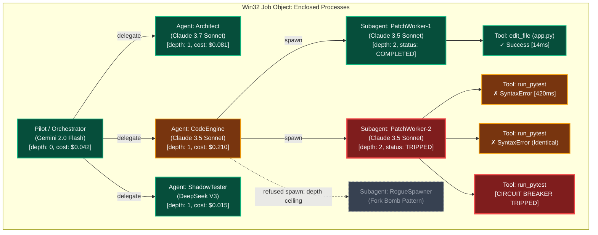
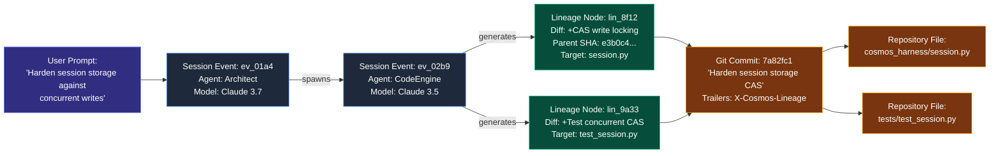

# Tracking and Tracing (TnT) in Multi-Model AI Agent Systems: Deep Research, Comparative Analysis & Architectural Blueprint

**Subject:** Complete Session Audit, Work Product Lineage, and Runaway Swarm Forensics  
**Target Systems:** COSMOS, The Harness (`cosmos_harness`), cmSessions, cmCode, cmClusters  
**Date:** November 2026  
**Status:** ARCHITECTURAL SPECIFICATION & COMPARATIVE BENCHMARK  

---

## Executive Summary

As multi-model AI agent systems evolve from single-turn chat assistants to autonomous multi-agent swarms (hierarchical orchestrators, parallel specialist subagents, peer-to-peer delegate seats), system failures shift from simple syntax errors to complex, non-deterministic system degradations:
1. **Invisible Hallucination & Retry Loops:** An agent repeatedly calls a tool with cosmetic modifications that fail identically, burning tokens without throwing an uncaught exception.
2. **Recursive Swarm Explosions (Fork Bombs):** An agent recursively spawns subagents to solve subtasks, leading to exponential process spawning, host resource exhaustion (`WinError 1816: Insufficient quota`), and API rate limit blacklisting.
3. **Ghost Mutations & Broken Provenance:** Code patches, file edits, database migrations, and remote API calls occur without a tamper-evident audit trail connecting the side-effect to the exact prompt turn, model pin, thinking trace, and subagent identity.

This report establishes **TnT (Tracking and Tracing)**: an integrated telemetry, provenance, and forensic runtime architecture designed specifically for multi-model swarms. It evaluates state-of-the-art industry platforms, defines the essential vs. bloated feature matrix, details the system architecture across the COSMOS/Harness stack, and provides concrete data models, forensic visualization designs, and production-ready loop-detection and circuit-breaker algorithms.

---

## 1. Comparative Product & Tool Analysis

We benchmarked eight industry observability/tracing platforms alongside enterprise provenance specifications against three core pillars of agent governance:
- **Pillar A: Complete Session Audit** (Exact prompt, raw tool calls, tool stdout/stderr, thinking process/extended reasoning, token breakdown, TTFT, per-step latencies).
- **Pillar B: Work Product Tracking & Lineage** (Cryptographic linkage of file diffs, commits, schema migrations, and API side-effects to the originating prompt turn, agent ID, and model pin).
- **Pillar C: "Haywire" Session Forensics & Active Mitigation** (Detection, visualization, and active runtime interception of infinite loops, recursive explosions, and runaway token velocity).

### 1.1 Comparative Matrix

| Platform / Tool | Architecture & Transport | Complete Session Audit | Work Product Lineage | Haywire Detection & Mitigation | Primary Weakness in Swarms |
| :--- | :--- | :--- | :--- | :--- | :--- |
| **LangSmith** | SaaS / Self-Host; Proprietary Run Tree REST API; LangChain/LangGraph native | **High**: Hierarchical Run Trees, inputs/outputs, latency, TTFT, token breakdowns, subagent/tool spans. | **Low**: Outputs logged as unstructured text/JSON. No native file diff, Git SHA, or OS side-effect linking. | **Medium**: Post-hoc tree visualization of deep recursions; rule-based alerts on total cost/errors; **no active runtime circuit breaker**. | Passive telemetry collector. Cannot stop runaway child processes or intercept local file corruption mid-flight. |
| **Langfuse** | Open Source (PostgreSQL + ClickHouse); REST / OpenTelemetry; SDK wrappers | **High**: Session $\rightarrow$ Trace $\rightarrow$ Observation (Span, Generation, Event). Captures model parameters, costs, latencies. | **Low**: Output payloads stored in blob/DB; no content-addressed lineage to workspace filesystem deltas. | **Low**: Post-hoc dashboard metrics. Visualizes deep traces, but lacks real-time loop detection or process killing. | Heavy database requirements (ClickHouse); asynchronous ingestion cannot act as a synchronous kill switch. |
| **AgentOps** | SaaS / Cloud Agent Ops; Python SDK decorators; Agent-centric data model | **High**: Custom event types (`Action`, `Tool`, `LLM`, `Error`). Captures tool execution time, parameters, stdout. | **Medium**: Tracks named "artifacts" if explicitly logged via SDK, but lacks cryptographic diff hashing or Git tree binding. | **High (Detection)**: Flags repetitive tool calls, recursion depth warnings, agent crash detection, cost runaway alerts. | Cloud-dependent; mitigation is limited to raising an exception in Python—cannot enforce OS-level process quotas or sandbox boundaries. |
| **Arize Phoenix / OpenInference** | Open Source / Cloud; OpenTelemetry native (`OTLP`); OpenInference semantic conventions | **High**: Standardized `openinference.span.kind` (`AGENT`, `LLM`, `TOOL`, `CHAIN`). Multi-turn messages, token counts, thinking traces. | **Low**: Focuses on evaluation datasets, embedding drifts, and RAG retrieval chunks. Zero filesystem/Git provenance. | **Medium (Visual)**: Beautiful waterfall/flamegraph trace viewer; detects long chains visually; no active circuit breaker. | Observability and evaluation platform, not an execution supervisor. |
| **Weights & Biases Weave** | Hybrid / Cloud; Object-versioned execution DAG (`@weave.op()`) | **Medium-High**: Captures inputs/outputs, model calls, latency, call trees. | **High (Code/Data)**: First-class versioning of code, prompts, and datasets in Weave artifact store. Weak on live workspace file diffs. | **Low**: Geared toward offline experiment tracking and offline evaluation rather than live agent swarm forensics. | High overhead; developer must structure code around `@weave.op()`; lacks active execution interception. |
| **Datadog LLM Observability** | Enterprise APM; Datadog Agent + APM Tracing (`ddtrace`) | **High**: Enterprise P99/P95 latencies, token consumption anomaly monitors, cluster-wide distributed traces. | **Low**: Treats LLM spans like traditional microservice RPCs. No workspace patch provenance. | **Medium**: Anomaly monitors detect sudden spend spikes, but alerts take 1-3 minutes to fire (too slow for 100k token/min loops). | Extreme commercial cost; closed-source; blind to local host filesystem actions and Win32 process trees. |
| **Helicone** | Edge Proxy / Gateway (wraps OpenAI/Anthropic baseURLs) | **Medium**: Captures exact HTTP request/response payloads, latency, caching headers, cost. Blind to local tool stdout/stderr. | **None**: Operates purely at the HTTP network boundary. Does not know what files were written or what commands were run. | **Low**: Rate limiting and budget caps per user/API key at the HTTP gateway; completely unaware of subagent child processes. | Blind to local execution: cannot see tool stdout/stderr, local process spawns, or workspace modifications. |
| **Enterprise Provenance (Git, SLSA, DVC, Pachyderm)** | Git SHA Merkle DAG, SLSA Attestations, DVC content-addressed data pointers | **Low (LLM context)**: Records commit SHAs, file trees, diffs, author identity, and build hermeticity. Completely unaware of LLM tokens/prompts. | **Very High**: Immutable, cryptographic content addressing (Merkle DAG), non-repudiable signing, tamper-evident history. | **Low**: Passive version control. Detects changes only when committed/staged. | Operates at the VCS/artifact boundary, completely disconnected from LLM reasoning, tokens, and multi-agent coordination. |
| **OpenTelemetry GenAI Semantic Conventions** | Vendor-neutral standard (`gen_ai.*` namespace via OTel Collector) | **High**: Standardized attributes (`gen_ai.operation.name`, `gen_ai.request.model`, `gen_ai.usage.*`). Privacy-aware payload capture. | **Low**: Standard defines the transport and telemetry vocabulary, not the lineage or workspace mutation graph. | **Low**: Purely a telemetry transport standard. Relies on downstream backends for analysis. | Stability is currently in active "Development" status; schemas change between minor releases. |

---

### 1.2 In-Depth Analysis of Critical Capabilities

#### 1. Complete Session Audit
- **The State of the Art:** LangSmith and Arize Phoenix excel at structuring conversational turns into hierarchical trees. Phoenix standardizes the schema using OpenInference, separating `input_messages`, `output_messages`, and tool parameters.
- **The Critical Gap:** Most platforms treat tool execution as a clean black-box JSON string (`{ "result": "..." }`). In real agent swarms (especially coding and systems agents), tool execution involves child processes emitting ANSI terminal output, interleaved stdout and stderr streams, exit codes, and memory peaks. Furthermore, emerging reasoning models (Gemini 2.0 Flash Thinking, Claude 3.7 Sonnet Thinking, OpenAI o3-mini) emit separate *thought traces* that must be isolated from the final assistant message to preserve clean context derivation (`derive == wire`). Existing tools frequently collapse thinking traces into the message body or omit them from span metadata entirely.

#### 2. Work Product Tracking & Lineage
- **The State of the Art:** Enterprise provenance tools (Git, SLSA, Pachyderm) use cryptographic Merkle DAGs. Every file state is identified by its SHA-256 hash. If an artifact changes by a single byte, its identity changes.
- **The Critical Gap:** AI observability platforms have almost zero integration with filesystem or VCS provenance. If an agent modifies `src/auth.py`, Langfuse records that a tool called `edit_file` returned `"Success"`. It does not record:
  - The unified diff applied.
  - The parent Git tree SHA before the edit and the resulting tree SHA.
  - The causal pointer linking the commit hash to `(session_id, event_seq, model_pin, prompt_sha)`.
  When a regression is discovered three days later, an engineer looking at Git cannot determine which subagent or prompt turn authored the flawed line of code.

#### 3. "Haywire" Session Forensics & Swarm Breakdowns
- **The Failure Modes:**
  1. *Syntactic Tool Retry Loop:* An agent calls `patch_file`, encounters a syntax error or rejection, and immediately retries the exact same call (or changes a single whitespace character), burning tokens indefinitely.
  2. *Ping-Pong Handoff Loop:* Agent A delegates to Agent B; Agent B encounters an ambiguity and messages Agent A; Agent A re-delegates to Agent B.
  3. *Fork Bomb / Swarm Explosion:* Agent A spawns 4 worker subagents; each worker spawns 4 sub-subagents to parse files; within 4 turns, 256 subagents are active, exhausting OS process handles (`WinError 1816`) and blasting API rate limits.
- **The State of the Art:** AgentOps provides basic repetition counting and threshold alerts. Datadog provides statistical cost anomaly alerts (after minutes).
- **The Critical Gap:** **None of the existing tools provide active, kernel-enforced circuit breakers.** They are passive observers: they log the disaster while the credit card is drained and the host OS exhausts its process tables. None combine *sliding-window signature hashing*, *semantic token-set distance*, and *Win32 Job Object process limits* into an autonomous execution sandbox.

---

## 2. Feature Assessment: What to Adopt, What to Cut

### 2.1 The Most Useful Features for Debugging Swarms (Must-Have)

1. **Content-Addressed Append-Only Session Journal (JSONL DAG):**
   - *Why:* Guarantees non-repudiation and prevents history rewrites. Every turn, tool invocation, and delegate message is hashed with a 16-hex character content address (`SHA-256(canonical(event))[:16]`). Rewinding, branching, or compacting are explicit append operations referencing parent event IDs.
2. **Unified Timeline with Synchronized Thought Traces & Stdio:**
   - *Why:* Debugging why an agent made a catastrophic tool call requires seeing the exact model "thinking" or internal monologue immediately preceding the call, paired with the unscrubbed stdout/stderr of the previous tool.
3. **Causal Work Product Lineage (File & Commit Binding):**
   - *Why:* Every code patch generated by the engine must embed a provenance header or Git trailer:
     `X-Cosmos-Lineage: session=<id> seq=<n> agent=<id> model=<pin> parent_sha=<sha>`.
     This allows instant bidirectional lookup: from any line of code in the repository back to the exact prompt and model turn, and from any session event to the resulting repository diff.
4. **Deterministic Multi-Stage Circuit Breakers:**
   - *Why:* Passive alerting is insufficient. The harness runtime must intercept tool execution synchronously *before* dispatching to the host or API.
5. **W3C Distributed Trace Context Propagation:**
   - *Why:* When a local pilot agent delegates a task to a remote delegate seat (e.g. cloud Hermes, Grok, or Claude worker), passing `traceparent` and `tracestate` headers preserves the full swarm tree across network boundaries.

### 2.2 Essential Loop-Detection and Circuit-Breaker Heuristics

| Heuristic | Mechanism | Trigger Threshold | Mitigation Action |
| :--- | :--- | :--- | :--- |
| **Exact Tool Signature Hash** | Sliding window of size $W=6$. Computes $H = \text{SHA256}(\text{tool\_name} + \text{canonical}(\text{args}))$. | $H$ appears $\ge 3$ times in window $W$. | **TRIP**: Halt turn immediately. Synthesize synthetic tool error explaining the repeated signature. Force agent to pause or ask human. |
| **Cosmetic Mutation / Levenshtein Ratio** | When tool is identical but arguments have slight edits (e.g. whitespace, variable rename) after a failure. | Jaccard similarity of normalized argument $n$-grams $> 0.88$ on consecutive failures. | **TRIP**: Refuse dispatch. Inject `[CIRCUIT_BREAKER: COSMETIC_RETRY_DETECTED]`. |
| **Normalized Error Echo** | Agent receives error string $E$ from tool $T$, and calls $T$ again yielding the identical normalized error $E$. | Count of identical consecutive error outputs $\ge 2$. | **TRIP**: Block subsequent invocation of $T$. Force reflection or plan modification. |
| **Swarm Tree Depth & Branching Ceiling** | Track depth in distributed trace context (`tracestate.depth`) and active child count. | `depth > 3` or `active_children > 8` or `total_swarm_agents > 16`. | **REFUSE**: `SWARM_EXPLOSION_PREVENTED`. Spawning call fails closed. |
| **Token Velocity Acceleration** | Compute token consumption rate: $V = \frac{\Delta \text{tokens}}{\Delta t}$ over 60 seconds. | $V > 50,000 \text{ tokens/min}$ or instantaneous spend $> \$2.00/\text{min}$. | **TRIP**: Suspend session. Trigger hard pause requiring manual override. |
| **Bipartite Ping-Pong Cycle** | Directed cycle detection in agent-to-agent message graph: $A \rightarrow B \rightarrow A \rightarrow B$. | Cycle length $\le 2$ repeated $\ge 2$ iterations without external tool progress. | **TRIP**: Intercept delegate message. Force parent orchestrator intervention. |

### 2.3 Bloated, Noisy, or Low-Value Features to Avoid

1. **Inline Dense Vector Embeddings on Every Stdio Line:**
   - *Why Avoid:* Running a BERT/text-embedding model on every chunk of compiler output or terminal stdout adds 200–500ms of latency per tool call and consumes host VRAM. Fast deterministic hashing (xxHash, SHA-256) and $n$-gram Jaccard shingling provide 100x faster loop detection with zero GPU dependency.
2. **Vague Sentiment and "Agent Mood" Tracking:**
   - *Why Avoid:* Commercial tools often promote "sentiment trends" across agent turns. For technical, coding, and infrastructure swarms, this is useless noise.
3. **Unbounded Raw Trace Buffering in Memory:**
   - *Why Avoid:* Buffering megabytes of raw terminal logs in the main process memory leads to memory fragmentation and OS quota crashes. Telemetry logs must stream to append-only JSONL files immediately, keeping only fixed-size bounded ring buffers in RAM.
4. **Silent Automatic Retries on Tool Failure:**
   - *Why Avoid:* Many agent frameworks implement hidden auto-retries when a tool fails. This directly violates the COSMOS house rule: *"Report, never retry. A failed step is recorded and surfaced; nothing silently re-runs."* Silent retries hide bugs and accelerate token burn.

### 2.4 Strictly Worth Adopting for Our Ecosystem

1. **Append-Only Content-Addressed JSONL Journal:** Mirroring `cosmos_harness/session.py` with 16-hex content addresses and parent chains.
2. **Deterministic Pre-Execution Circuit Breaker Ring:** Implemented in `cosmos_harness/engine.py` as a synchronous dispatch interceptor.
3. **Win32 Job Object Enclosure Integration:** Binding every spawned subprocess and subagent process tree into a kernel-level Job Object with `KILL_ON_JOB_CLOSE` and active process limits.
4. **Git Provenance Trailing & Diff Anchoring:** Storing `.cosmos/lineage/` records alongside every patch generated by `diff_engine.py`.
5. **OpenTelemetry-Compatible Trace Context Propagation:** Standard W3C `traceparent` headers across all subagent invocations.

---

## 3. Architecture & Ecosystem Fit

The TnT architecture spans the five core layers of the COSMOS ecosystem:

```
+---------------------------------------------------------------------------------------+
|                                    COSMOS CORE                                        |
|  - Global Audit Event Broker (append-only ledger authority: ledger.jsonl)             |
|  - Cryptographic Hash Chains & Tamper Verification (TAMPERED status)                  |
|  - Global Security Boundaries & Path Jails                                            |
|  - Forensic Replay Engine (Deterministic Time-Travel Replay)                          |
+-------------------------------------------+-------------------------------------------+
                                            |
                    +-----------------------+-----------------------+
                    |                                               |
+-------------------v-------------------+       +-------------------v-------------------+
|               cmCode                  |       |             cmSessions                |
|  - Work Product Diff Lineage Engine   |       |  - Unified Session Audit Log Viewer   |
|  - Commit / Patch Provenance Trailers |       |  - Hierarchical Flame Graph Waterfall |
|  - File Modification Churn Heatmap    |       |  - Subagent Tree DAG Visualizer       |
|  - Multi-Agent Contention Locks       |       |  - Blast Radius & Quota Inspector     |
+-------------------+-------------------+       +-------------------+-------------------+
                    |                                               |
                    +-----------------------+-----------------------+
                                            |
+-------------------------------------------v-------------------------------------------+
|                                    THE HARNESS                                        |
|  - Runtime Telemetry Interceptor (Prompt/Completion/Cached tokens, TTFT, Latency)     |
|  - Pre-Dispatch Loop Detector & Circuit Breaker (Signature Hash Ring, Error Echo)     |
|  - Kill Switch & Process Execution Enclosure (Win32 Job Object limits: Process/RAM)  |
|  - Credentials & Secrets Scrubber (Fail-closed sandbox enclosure)                     |
+-------------------------------------------+-------------------------------------------+
                                            |
+-------------------------------------------v-------------------------------------------+
|                                    cmClusters                                         |
|  - Distributed W3C Trace Context Propagation (traceparent / tracestate)               |
|  - Swarm Blast Radius Confinement (Hierarchical Quota Budgets per Subagent Branch)    |
|  - Cross-Seat Delegate Audit (Local Desktop <-> Cloud Delegate Nodes)                 |
+---------------------------------------------------------------------------------------+
```

### 3.1 Layer Responsibilities & Integration Details

#### 1. cmSessions: The Forensic Cockpit
- **Audit Log View:** Displays the raw, immutable content-addressed JSONL DAG. Provides filterable views for user messages, model thinking blocks, raw tool calls, tool stdout/stderr, and synthesized interruptions.
- **Flame Graph Waterfall:** Visualizes execution latency across nested spans:
  - Top level: Orchestrator turn duration.
  - Intermediate level: Subagent delegation spans and LLM TTFT (Time-to-First-Token) vs. generation duration.
  - Leaf level: Tool execution latency (e.g. compilation, test runs, disk I/O).
- **Subagent Tree Visualizer:** Real-time interactive node DAG displaying the swarm hierarchy. Color-coded node health:
  - `GREEN (NORMAL)`: Active execution within budget and velocity limits.
  - `AMBER (WARNING)`: Repeated tool signature detected (1 retry left).
  - `RED (TRIPPED)`: Circuit breaker tripped; subagent paused.
  - `GRAY (KILLED)`: Hard kill switch triggered via Win32 Job Object closure.
- **Blast Radius Inspector:** Visualizes all files modified, commands executed, network sockets opened, and child processes spawned by a specific subagent branch.

#### 2. cmCode: Work Product & Artifact Lineage
- **Code Artifact Diff Lineage:** Whenever an agent modifies code via `diff_engine.py` or writes a new file, cmCode calculates the SHA-256 of the before/after state and writes an immutable lineage node:
  ```json
  {
    "artifact_sha": "a1b2c3d4e5f60718...",
    "file_path": "src/core/router.py",
    "patch_unified": "--- a/src/core/router.py\n+++ b/src/core/router.py\n...",
    "origin": {
      "session_id": "sess_8f902a1b",
      "event_id": "ev_4c2d890e",
      "agent_id": "code_refactor_agent",
      "model_pin": "claude-3-7-sonnet",
      "prompt_hash": "sha256:77f1...",
      "timestamp": 1794218492.104
    }
  }
  ```
- **Commit/Patch Provenance:** Integration with Git commit metadata. Commits created by the swarm include standard Git trailers:
  ```
  Fix router path matching regression
  
  X-Cosmos-Session: sess_8f902a1b
  X-Cosmos-Event: ev_4c2d890e
  X-Cosmos-Agent: code_refactor_agent
  X-Cosmos-Model: claude-3-7-sonnet
  X-Cosmos-SLSA-Level: 1
  ```
- **File Modification Heatmaps:** Identifies hot files touched across multiple turns or multiple subagents. Flags potential merge collisions or conflicting instructions before agents overwrite each other's changes.

#### 3. COSMOS Core: Global Audit Authority
- **Global Event Broker:** Append-only ledger authority (`ledger.jsonl`). Every state change, cluster member addition, tool authorization, and circuit breaker trip is recorded with a monotonic sequence number (`seq`) and content address.
- **Tamper-Evident Hash Chain:** Validates that no historical events have been edited or deleted. If any line fails its hash check, COSMOS marks the session `TAMPERED` and refuses further operations.
- **Deterministic Replay Logs:** Allows the entire session or subagent run to be replayed deterministically in a virtual harness using cached provider responses and recorded tool outputs.

#### 4. The Harness (`cosmos_harness`): Runtime Supervisor
- **Runtime Telemetry Interceptor:** Sits between the engine and the model provider. Measures TTFT, prompt tokens, completion tokens, cached tokens, and calculates dollar spend against active rate levels and daily spend limits (`spend.jsonl`).
- **Synchronous Circuit Breaker:** Evaluates tool calls against the loop detection heuristics *prior* to executing the tool. If a loop is detected, it trips immediately without invoking the external command.
- **Win32 Job Object Enclosure:** Configured via `JOBOBJECT_EXTENDED_LIMIT_INFORMATION` with `KILL_ON_JOB_CLOSE (0x2000)`, `DIE_ON_UNHANDLED_EXCEPTION (0x0400)`, and strict active process limits (e.g. 4 for oracles, 16 for test suites). If a subagent spawns runaway child processes, closing the job handle terminates the entire process tree instantly at the kernel level, completely eliminating orphan processes.

#### 5. cmClusters: Swarm Observability & Propagation
- **Distributed Trace Propagation:** Propagates W3C trace headers across process and network boundaries:
  - `traceparent: 00-4bf92f3577b34da6a3ce929d0e0e4736-00f067aa0ba902b7-01`
  - `tracestate: cosmos=s:sess_8f902,a:worker_3,d:2,b:1.50` (seat, agent, depth, budget).
- **Swarm Blast Radius Confinement:** Budgets (dollar spend, token count, max tool calls) are partitioned hierarchically. An orchestrator allocates \$1.00 to Subagent A and \$0.50 to Subagent B. If Subagent B trips a circuit breaker or exhausts its \$0.50 budget, only Subagent B is killed; the orchestrator and Subagent A remain completely healthy.

---

## 4. Concrete Data Models

The following schemas define the canonical JSON structures for the TnT subsystem.

### 4.1 Canonical Audit Event Schema (`cosmos-audit-event/1`)

Every line in a session's `.events.jsonl` implements this schema. Content addressing is enforced: `id == sha256(canonical(body))[:16]`.

```json
{
  "$schema": "http://json-schema.org/draft-07/schema#",
  "title": "CosmosAuditEvent",
  "type": "object",
  "required": ["v", "id", "parent", "seq", "ts", "trace", "ev", "data"],
  "properties": {
    "v": { "type": "integer", "enum": [1] },
    "id": { "type": "string", "pattern": "^[0-9a-f]{16}$" },
    "parent": { "type": ["string", "null"], "pattern": "^[0-9a-f]{16}$" },
    "seq": { "type": "integer", "minimum": 0 },
    "ts": { "type": "number", "description": "Unix epoch timestamp with microsecond precision" },
    "trace": {
      "type": "object",
      "required": ["trace_id", "span_id", "depth"],
      "properties": {
        "trace_id": { "type": "string", "pattern": "^[0-9a-f]{32}$" },
        "span_id": { "type": "string", "pattern": "^[0-9a-f]{16}$" },
        "parent_span_id": { "type": ["string", "null"], "pattern": "^[0-9a-f]{16}$" },
        "depth": { "type": "integer", "minimum": 0 },
        "agent_id": { "type": "string" },
        "seat_id": { "type": "string" }
      }
    },
    "ev": {
      "type": "string",
      "enum": [
        "user/message",
        "assistant/message",
        "assistant/thinking",
        "tool/invoke",
        "tool/result",
        "tool/refuse",
        "agent/spawn",
        "agent/terminate",
        "circuit_breaker/trip",
        "artifact/lineage",
        "session/rewind",
        "session/fork",
        "session/compact"
      ]
    },
    "data": { "type": "object" }
  }
}
```

### 4.2 Python Dataclasses for TnT Runtime

```python
"""cosmos_harness/tnt_models.py - Core data models for Tracking and Tracing."""

from __future__ import annotations

import hashlib
import json
import time
from dataclasses import asdict, dataclass, field
from typing import Any, Mapping


def canonical_json(obj: Any) -> str:
    """Deterministic JSON serialization: sorted keys, no whitespace separators."""
    return json.dumps(obj, sort_keys=True, separators=(",", ":"), ensure_ascii=False)


def compute_id(body: Mapping[str, Any]) -> str:
    """16-hex content address from canonical JSON."""
    return hashlib.sha256(canonical_json(body).encode("utf-8")).hexdigest()[:16]


@dataclass(frozen=True)
class TraceContext:
    """W3C Trace Context and Swarm Hierarchy Carrier."""
    trace_id: str                      # 32 hex chars (128-bit)
    span_id: str                       # 16 hex chars (64-bit)
    parent_span_id: str | None = None  # 16 hex chars or None
    depth: int = 0
    agent_id: str = "orchestrator"
    seat_id: str = "local"

    def to_w3c_traceparent(self) -> str:
        return f"00-{self.trace_id}-{self.span_id}-01"

    def to_w3c_tracestate(self) -> str:
        return f"cosmos=a:{self.agent_id},d:{self.depth},s:{self.seat_id}"


@dataclass(frozen=True)
class ToolSpan:
    """Detailed record of a tool execution step."""
    call_id: str
    tool_name: str
    parameters: dict[str, Any]
    param_hash: str                    # SHA-256 of canonical params
    start_ts: float
    end_ts: float
    duration_ms: float
    exit_code: int
    stdout_scrubbed: str
    stderr_scrubbed: str
    output_truncated: bool
    enclosure_status: str              # policy_only, win32_job, refused


@dataclass(frozen=True)
class WorkProductLineage:
    """Lineage link between generated code/artifacts and LLM turns."""
    artifact_id: str                   # sha256 of the artifact content
    path: str
    diff_unified: str
    parent_file_sha: str
    new_file_sha: str
    session_id: str
    event_id: str
    agent_id: str
    model_pin: str
    prompt_hash: str
    timestamp: float = field(default_factory=time.time)

    def to_dict(self) -> dict[str, Any]:
        return asdict(self)


@dataclass
class CircuitBreakerStatus:
    """Live state of the loop detector and circuit breaker."""
    is_tripped: bool = False
    trip_reason: str | None = None
    violation_count: int = 0
    consecutive_error_count: int = 0
    recent_signatures: list[str] = field(default_factory=list)
    tokens_window_start: float = field(default_factory=time.time)
    tokens_accumulated: int = 0
```

---

## 5. Forensic Visualizations

### 5.1 Subagent Swarm Execution Tree (DAG)

Visualizing hierarchical agent spawning, tool invocations, circuit breaker states, and kernel enclosure boundaries:



### 5.2 Unified Latency & Thinking Flame Graph

Timeline breakdown illustrating Time-to-First-Token (TTFT), Extended Thinking / Reasoning duration, Tool execution, and standard response streaming:

```
[0.0s]                                                                                     [6.5s]
+-----------------------------------------------------------------------------------------------+
| User Turn: "Fix the concurrency race condition in session router and verify tests"            |
+-----------------------------------------------------------------------------------------------+
  |
  +-- [Pilot Agent: LLM Call 1] (Gemini 2.0 Flash) [Total: 1.8s]
  |   |-- [TTFT: 280ms]
  |   |-- [Thinking / Reasoning Trace: 920ms] (Tokens: 1,420)
  |   +-- [Output Streaming: 600ms] -> Tool Call: delegate(agent="CodeEngine")
  |
  +-- [CodeEngine Subagent] (Claude 3.7 Sonnet) [Total: 4.4s]
      |-- [LLM Call 2: TTFT: 310ms | Thinking: 1,200ms | Output: 400ms]
      |   +-- Emits Tool Call: patch_file("src/router.py", unified_diff)
      |
      |-- [Tool Execution: patch_file] [Duration: 42ms]
      |   |-- Win32 Path Jail Validation (OK)
      |   |-- Lineage Node Generated (SHA: f4a89c...)
      |   +-- Return: "Applied chunk 1 of 1 cleanly"
      |
      |-- [LLM Call 3: TTFT: 290ms | Thinking: 650ms | Output: 350ms]
      |   +-- Emits Tool Call: run_concurrency_test()
      |
      +-- [Tool Execution: run_concurrency_test] [Duration: 1,158ms]
          |-- Win32 Job Object Enclosure (Active process limit: 4)
          |-- Stdout/Stderr captured & credential scrubbed
          +-- Return: "PASS: 50/50 threads completed without deadlocks"
```

### 5.3 Work Product Lineage & Blast Radius Graph

Connecting user intent to specific prompts, model turns, diff engines, and Git commit artifacts:



---

## 6. Production-Ready Algorithms & Implementation

The following complete Python module (`cosmos_harness/tnt_circuit_breaker.py`) is designed for direct integration into `cosmos_harness`. It provides:
1. Exact tool signature sliding-window hashing.
2. Normalized error echo detection.
3. Fast cosmetic retry detection (token-set Jaccard distance without GPU dependencies).
4. Swarm depth ceiling enforcement.
5. Token velocity ceiling enforcement.
6. Fail-closed circuit breaker trip state.

```python
"""cosmos_harness/tnt_circuit_breaker.py

TnT Production Loop Detector and Pre-Dispatch Circuit Breaker for COSMOS Harness.
Strictly adheres to: Fail-closed, Report-never-retry, Standard-library only.
"""

from __future__ import annotations

import hashlib
import json
import re
import time
from collections import deque
from dataclasses import dataclass, field
from typing import Any, Mapping, Sequence


class CircuitBreakerTripped(Exception):
    """Raised when the pre-dispatch circuit breaker intercepts an execution loop."""
    def __init__(self, rule: str, reason: str, details: dict[str, Any]):
        super().__init__(f"CIRCUIT_BREAKER_TRIPPED [{rule}]: {reason}")
        self.rule = rule
        self.reason = reason
        self.details = details


@dataclass
class CircuitBreakerConfig:
    """Configurable thresholds for runaway swarm interception."""
    # 1. Exact Signature Match
    signature_window_size: int = 6
    max_identical_signatures: int = 3

    # 2. Normalized Error Echo
    max_consecutive_identical_errors: int = 2

    # 3. Cosmetic Retry Detection (Token-set Jaccard)
    cosmetic_similarity_threshold: float = 0.88

    # 4. Swarm Hierarchy Ceilings
    max_agent_depth: int = 3
    max_concurrent_subagents: int = 8

    # 5. Token Velocity Ceilings
    token_velocity_window_seconds: float = 60.0
    max_tokens_per_minute: int = 60_000
    max_cost_per_minute_usd: float = 2.00


class LoopDetector:
    """Synchronous runtime interceptor analyzing agent execution patterns."""

    def __init__(self, config: CircuitBreakerConfig | None = None) -> None:
        self.config = config or CircuitBreakerConfig()
        # Sliding history of tool signatures: deque of (sig_hash, tool_name, raw_args_str)
        self._tool_history: deque[tuple[str, str, str]] = deque(maxlen=self.config.signature_window_size)
        # History of error outputs: deque of normalized_error_hash
        self._error_history: deque[str] = deque(maxlen=5)
        # Token spend tracking: list of (timestamp, token_count, cost_usd)
        self._spend_history: deque[tuple[float, int, float]] = deque(maxlen=100)
        # Circuit state
        self._tripped: bool = False
        self._trip_reason: str | None = None

    @property
    def is_tripped(self) -> bool:
        return self._tripped

    @property
    def trip_reason(self) -> str | None:
        return self._trip_reason

    def reset(self) -> None:
        """Reset state upon explicit user override/unpause."""
        self._tool_history.clear()
        self._error_history.clear()
        self._spend_history.clear()
        self._tripped = False
        self._trip_reason = None

    def record_usage(self, tokens: int, cost_usd: float) -> None:
        """Record token consumption and check instantaneous velocity."""
        now = time.time()
        self._spend_history.append((now, tokens, cost_usd))

        # Evict records older than velocity window
        cutoff = now - self.config.token_velocity_window_seconds
        while self._spend_history and self._spend_history[0][0] < cutoff:
            self._spend_history.popleft()

        total_tokens = sum(t for _, t, _ in self._spend_history)
        total_cost = sum(c for _, _, c in self._spend_history)

        if total_tokens > self.config.max_tokens_per_minute:
            self._trip(
                "TOKEN_VELOCITY_CEILING",
                f"Burned {total_tokens} tokens in <60s (limit: {self.config.max_tokens_per_minute})",
                {"total_tokens": total_tokens, "window_seconds": self.config.token_velocity_window_seconds}
            )

        if total_cost > self.config.max_cost_per_minute_usd:
            self._trip(
                "COST_VELOCITY_CEILING",
                f"Spend rate ${total_cost:.3f}/min exceeded limit ${self.config.max_cost_per_minute_usd:.2f}",
                {"total_cost": total_cost}
            )

    def record_tool_result(self, exit_code: int, output: str) -> None:
        """Inspect tool result. If an error occurred, check for error echo loops."""
        if exit_code != 0:
            norm_error = self._normalize_error(output)
            error_hash = hashlib.sha256(norm_error.encode("utf-8")).hexdigest()[:16]
            self._error_history.append(error_hash)

            # Check consecutive identical errors
            consecutive = 0
            for prev_hash in reversed(self._error_history):
                if prev_hash == error_hash:
                    consecutive += 1
                else:
                    break

            if consecutive >= self.config.max_consecutive_identical_errors:
                self._trip(
                    "ERROR_ECHO_LOOP",
                    f"Tool failed with identical normalized error {consecutive} times in a row.",
                    {"error_sample": norm_error[:300], "consecutive_failures": consecutive}
                )
        else:
            # Clean exit clears the consecutive error chain
            self._error_history.clear()

    def inspect_tool_call(self, tool_name: str, args: Mapping[str, Any], depth: int = 0) -> None:
        """Pre-dispatch interceptor. MUST be invoked BEFORE tool execution.
        
        Raises CircuitBreakerTripped if any loop condition is verified.
        """
        if self._tripped:
            raise CircuitBreakerTripped("CIRCUIT_OPEN", self._trip_reason or "Circuit breaker remains open", {})

        # 1. Swarm Depth Check
        if depth > self.config.max_agent_depth:
            self._trip(
                "MAX_DEPTH_EXCEEDED",
                f"Subagent nesting depth {depth} exceeds ceiling of {self.config.max_agent_depth}",
                {"current_depth": depth, "max_depth": self.config.max_agent_depth}
            )

        # 2. Canonical Signature Generation
        args_json = json.dumps(args, sort_keys=True, separators=(",", ":"), ensure_ascii=False)
        sig_raw = f"{tool_name}:{args_json}"
        sig_hash = hashlib.sha256(sig_raw.encode("utf-8")).hexdigest()[:16]

        # 3. Exact Repetition Check
        identical_count = sum(1 for prev_hash, _, _ in self._tool_history if prev_hash == sig_hash)
        if identical_count >= (self.config.max_identical_signatures - 1):
            self._trip(
                "REPEATED_TOOL_SIGNATURE",
                f"Tool '{tool_name}' called with identical arguments {identical_count + 1} times.",
                {"tool_name": tool_name, "signature_hash": sig_hash, "args": args}
            )

        # 4. Cosmetic Retry Check (Token-set Jaccard similarity against recent calls of the same tool)
        for _, prev_tool, prev_args_str in reversed(self._tool_history):
            if prev_tool == tool_name:
                sim = self._jaccard_similarity(prev_args_str, args_json)
                # If highly similar but not exact, and the last tool output was an error
                if self.config.cosmetic_similarity_threshold <= sim < 1.0 and len(self._error_history) > 0:
                    self._trip(
                        "COSMETIC_RETRY_LOOP",
                        f"Detected cosmetic mutation retry (similarity: {sim:.3f}) following tool failure.",
                        {"tool_name": tool_name, "similarity": sim}
                    )
                break

        # Record this invocation
        self._tool_history.append((sig_hash, tool_name, args_json))

    def _trip(self, rule: str, reason: str, details: dict[str, Any]) -> None:
        """Trips the circuit breaker fail-closed."""
        self._tripped = True
        self._trip_reason = f"[{rule}] {reason}"
        raise CircuitBreakerTripped(rule, reason, details)

    @staticmethod
    def _normalize_error(raw_output: str) -> str:
        """Strips timestamps, memory addresses, and file line numbers to expose root error shape."""
        text = raw_output.lower()
        # Remove hexadecimal addresses (0x7fff...)
        text = re.sub(r"0x[0-9a-fA-F]+", "0xADDR", text)
        # Remove ISO timestamps and microsecond clocks
        text = re.sub(r"\d{4}-\d{2}-\d{2}t\d{2}:\d{2}:\d{2}(\.\d+)?z?", "TIMESTAMP", text)
        # Normalize line numbers (line 42 -> line NUM)
        text = re.sub(r"line \d+", "line NUM", text)
        return " ".join(text.split()[:100])  # Focus on first 100 normalized tokens

    @staticmethod
    def _jaccard_similarity(str_a: str, str_b: str) -> float:
        """Fast character 4-gram shingle Jaccard similarity."""
        if str_a == str_b:
            return 1.0
        if not str_a or not str_b:
            return 0.0
        shingles_a = {str_a[i:i+4] for i in range(max(1, len(str_a) - 3))}
        shingles_b = {str_b[i:i+4] for i in range(max(1, len(str_b) - 3))}
        intersection = len(shingles_a & shingles_b)
        union = len(shingles_a | shingles_b)
        return intersection / union if union > 0 else 0.0
```

---

## 7. Concrete Implementation Roadmap for COSMOS

1. **Phase 1: Harness Runtime Integration (Target: `cosmos_harness`)**
   - Incorporate `cosmos_harness/tnt_circuit_breaker.py`.
   - Wrap `Engine.run()` and `Engine._dispatch()` to invoke `inspect_tool_call()` before any tool execution.
   - Attach `LoopDetector.record_usage()` to `Telemetry.add()` to ensure immediate token velocity monitoring.
2. **Phase 2: Work Product Lineage Engine (Target: `cosmos_harness/diff_engine.py` & `cmCode`)**
   - Emit a content-addressed `WorkProductLineage` record upon every successful `edit_file` or `write_file`.
   - Embed Git trailers (`X-Cosmos-Lineage`) on automated commits.
3. **Phase 3: Visual Cockpit & Sessions Page (Target: `cmSessions` & `builds/sessions-page`)**
   - Extend `sessions_page.py` API with `GET /api/v1/sessions/<id>/trace` returning hierarchical trace trees.
   - Render the interactive DOM Flame Graph and Subagent DAG in the Blackline UI.
4. **Phase 4: Distributed W3C Context Propagation (Target: `cmClusters`)**
   - Add `traceparent` and `tracestate` headers to inter-seat agent messaging protocols.
   - Enforce branch-level quota partitioning across local and cloud delegate seats.
